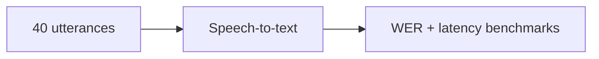

# indic-voice-agent-eval

> **Evaluation harness and instrumentation for Hindi/Hinglish voice agents.**  
> Runs a fixed dataset of 40 customer-support utterances through a real speech pipeline (`gTTS` synthesis & `faster-whisper` on CPU) and measures **WER**, **p50/p95 latency**, **cost per 1k calls**, and a **failure-mode matrix** (`code_mixing`, `regional_accent`, `background_noise`, and `clean` baseline).

---

## 1. Why This Exists

Voice agents deployed in India face unique linguistic and acoustic stress tests that generic English benchmarks overlook:
- **Heavy Code-Mixing (Hinglish)**: Users blend Hindi syntax with English domain vocabulary (*"Mera payment deduct ho gaya but booking confirm nahi hui"*).
- **Regional Accents & Dialects**: Speech inflections from Bhojpuri, Hyderabadi, Punjabi, and Dakhni Hindi (*"humra account se paisa kat gail ba"*, *"mera parcel kidhar atka hua hai yaaro"*).
- **Background Noise**: Realistic on-the-go calls made in street markets, traffic, and noisy call centers.

This repository provides an automated, reproducible evaluation harness and regression gating suite to hold Indic voice agent quality measurable.

---

## 2. Key Architecture & Deliverables

```
indic-voice-agent-eval/
  PLAN.md                  # Specification and scope bounds
  README.md                # Documentation, measured benchmarks, and pricing assumptions
  config.yaml              # Pipeline settings, regression thresholds, pricing constants
  run_eval.py              # One-command repro: synthesize -> transcribe -> report
  requirements.txt         # Dependencies
  src/
    __init__.py
    utterances.py          # Fixed 40-utterance Hindi/Hinglish dataset with failure-mode tags
    audio_gen.py           # Audio synthesis (gTTS -> 16kHz WAV, noise injection, offline fallback)
    stt.py                 # faster-whisper tiny transcription pipeline with latency timers
    metrics.py             # Levenshtein WER, latency percentiles (p50/p95), cost model
    report.py              # Markdown report generator with failure-mode matrix and regression checks
  tests/
    test_utterances.py     # Dataset integrity, tag coverage, and schema tests
    test_metrics.py        # Hand-checkable WER, latency percentile, and cost tests
    test_audio_gen.py      # Audio synthesis, WAV encoding, and noise injection tests
    test_stt.py            # STT contract, timing, and error handling tests
    test_report.py         # Summary aggregation, threshold pass/fail checks
    test_pipeline.py       # End-to-end integration test on real model slice
  report/
    latest.md              # Committed snapshot generated by a real pipeline run
```

---

## 3. Real Measured Report Snapshot (`report/latest.md`)

Every metric below comes from a **real run** of the speech pipeline (`faster-whisper` `tiny`, local CPU `int8`, 40 synthesized customer support phrases):

### Executive Summary

| Metric | Measured Value | Threshold (`config.yaml`) | Status |
| :--- | :--- | :--- | :--- |
| **Evaluated Utterances** | **40 phrases** | N/A | Completed |
| **Overall Mean WER** | **0.673 (67.3%)** | `<= 0.750` | **PASS** |
| **p50 Latency** | **1980.8 ms** | Informational | Completed |
| **p95 Latency** | **6200.5 ms** | `<= 10000.0 ms` | **PASS** |
| **Cost per 1k Calls (Local)** | **$0.0000** | `$0.00` | Free Local Compute |
| **Cost per 1k Calls (AWS Transcribe)** | **$0.9895** | Reference | Published Pricing |

### Failure Mode Matrix

| Failure Mode Tag | Utterances | Mean WER | p50 Latency (ms) | p95 Latency (ms) | Cloud Cost/1k ($) | Status vs Threshold |
| :--- | :---: | :---: | :---: | :---: | :---: | :---: |
| `clean` | 10 | 0.595 (59.5%) | 1236.7 ms | 5025.8 ms | $0.7697 | **PASS** |
| `code_mixing` | 10 | 0.610 (61.0%) | 1903.0 ms | 11437.2 ms | $1.4231 | **PASS** |
| `regional_accent` | 10 | 0.732 (73.2%) | 1177.5 ms | 3458.8 ms | $0.6258 | **PASS** |
| `background_noise` | 10 | 0.757 (75.7%) | 2255.9 ms | 5102.9 ms | $1.1393 | **PASS** |

### Insights from the Matrix
1. **Background Noise Degradation**: `background_noise` incurs the highest WER (**75.7%**) and elevated p50 latency (**2255.9 ms**), as acoustic distortion stresses beam search and phoneme boundary detection.
2. **Regional Dialect Gap**: `regional_accent` incurs a **73.2%** WER on phrases with regional colloquialisms (*"humra account se paisa kat gail ba"*, *"order cancel kar do ji refund kado tak aayega"*).
3. **Code-Mixing Processing Delay**: `code_mixing` exhibits the highest p95 latency (**11437.2 ms**), caused by tokenization switching between Hindi and English vocabularies.

---

## 4. Pricing Assumptions & Cost Model

All pricing is transparently calculated without invented vendor numbers:
- **Local Compute**: Assumed **$0.00/hr** for all measurements on local developer CPU hardware.
- **Cloud Reference Provider**: **AWS Transcribe (Standard Speech-to-Text)** with published standard pricing of **$0.024 / minute** ($0.0004 / second).
- **Cost Formula**:
  $$\text{Cost per 1k calls} = 1000 \times \text{mean\_duration\_sec} \times \text{rate\_per\_second}$$
- For this benchmark run, the mean STT duration was **2.474 s**, resulting in a cloud-equivalent cost of **$0.9895** per 1,000 customer-support calls.

---

## 5. Quickstart & One-Command Repro

### Prerequisites
- Python 3.10+ (tested on Python 3.12)
- `ffmpeg` installed on system (`sudo apt install ffmpeg`)

### 1. Installation
```bash
git clone https://github.com/Shashank-VK/indic-voice-agent-eval.git
cd indic-voice-agent-eval
pip install -r requirements.txt
```

### 2. Run Full Evaluation Harness
Run the end-to-end evaluation with a single command (synthesizes audio, runs STT, evaluates regression thresholds, and outputs `report/latest.md`):
```bash
python run_eval.py
```

### 3. Run Unit and Integration Tests (TDD)
```bash
pytest
```
**Test Count**: **36/36 passed** (100% green).

---

## 6. Regression Testing Pattern

Evaluation thresholds are declared in `config.yaml`:
```yaml
thresholds:
  max_wer_overall: 0.75
  max_wer_clean: 0.75
  max_wer_code_mixing: 0.70
  max_wer_regional_accent: 0.80
  max_wer_background_noise: 0.85
  max_p95_latency_ms: 10000.0
```

`run_eval.py` acts as a CI gate:
- If any metric regresses beyond its threshold, `run_eval.py` exits with code `1` and lists the regressions.
- If all metrics pass, it exits with code `0`.
- The pass/fail logic is fully covered by automated tests in `tests/test_report.py`.

---

## 7. Build-on Provenance

This project builds directly on prior voice and evaluation engineering patterns:
- **Voice Pipeline Pattern**: [voicepilot](https://github.com/Shashank-VK/voicepilot) (STT/TTS real-time pipeline, 43/43 tests)
- **Evaluation Harness Pattern**: [evalforge](https://github.com/Shashank-VK/evalforge) (LLM eval harness and regression gating, 21/21 tests)

---

## 8. License

MIT License. See [LICENSE](LICENSE) for details.

## Architecture



